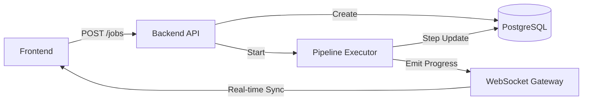

# Job Processing

## Task

A technical assessment project for the **Full-Stack JS Engineer** position. The application is a centralized system for multi-step data processing (Pipeline) featuring real-time progress visualization via WebSockets and an alternative HTTP Polling mechanism.

## Phase 0 — Design & Architecture

### User Scenarios

1. **WebSocket Processing (Real-time)**: The user completes the onboarding flow and selects the WS method. The system creates a database record, opens a socket connection, and broadcasts each processing step (0–100%) in real-time.
2. **HTTP Processing (Polling)**: The user selects the HTTP method. The frontend initiates the job and cyclically queries the API (`GET /jobs/:id`) until the status reaches `done`, displaying an indeterminate loading state during the interval.

### Technical Logic

* **Job Processing**: Tasks are handled by an asynchronous Pipeline Executor. Each step emulates a workload (delay) and updates the job's state in the database.
* **Status Updates**:
* **WS**: The server utilizes Socket.io Gateways to push notifications to a specific room identified by the `jobId`.
* **HTTP**: The client independently manages a request queue to pull the latest state from the database.


### High-level Flow



## What Was Done

### Backend (NestJS + Prisma + PostgreSQL)

* **Proxy Pipeline Pattern**: Implemented a middleware-style execution wrapper. Using a `Proxy` allows the system to automatically update the DB and emit socket events without hardcoding side effects into the core pipeline step functions.
* **Real-time Architecture**: Configured a Socket.io Gateway with room support, ensuring users only receive updates for their specific `jobId`.
* **Reliable Data Lifecycle**: Jobs follow a strict state machine: `queued` → `processing` → `done` / `failed`.

### Frontend (Next.js 15 + Tailwind CSS + Framer Motion)

* **Pixel-Perfect Onboarding**: Faithfully recreated the design from Figma, including Geologica/Nunito typography, gradient progress bars, and smooth header transitions.
* **Advanced State Management**: Utilized Zustand to manage a 4-step form with automatic unit conversion (kg/lbs) and real-time input validation.
* **Unified Progress UI**: Developed a dynamic progress component that adapts between real-time data streams (WS) and indeterminate loading states (Polling).

## Core Technologies

* **Next.js 15 (App Router)** & **TypeScript**
* **NestJS** (Modular Architecture)
* **Prisma ORM** & **PostgreSQL** (via Supabase)
* **Socket.io** (WebSockets)
* **Framer Motion** (Animations) & **Zustand** (State)

## Project Structure

```text
/
├── backend/            # NestJS Server
│   ├── src/
│   │   ├── jobs/       # API, Gateways & Pipeline logic
│   │   ├── prisma/     # Database service & Generated client
│   │   └── main.ts     # Entry point (CORS, Socket setup)
│   └── prisma/         # Schema definitions
├── frontend/           # Next.js Client
│   ├── src/
│   │   ├── app/        # Onboarding multi-step flow
│   │   ├── components/ # Header, Circular Progress, Review Cards
│   │   ├── hooks/      # useJobExecution (WS/Polling logic)
│   │   └── store/      # Zustand global state

```

## Setup Instructions

### 1. Backend

```shell
cd backend
npm install
npx prisma generate
npx prisma db push
npm run start:dev

```

*Environment (`backend/.env`):* `DATABASE_URL` (PostgreSQL connection string).

### 2. Frontend

```shell
cd frontend
npm install
npm run dev

```

*Environment (`frontend/.env.local`):* `NEXT_PUBLIC_API_URL=http://localhost:3001`.

## API Endpoints

* `POST /jobs` — Create a new job with user parameters (returns `id`).
* `GET /jobs/:id` — Fetch the current status and progress from the database.
* **WS** `jobUpdate` — Real-time event containing progress percentage and status.